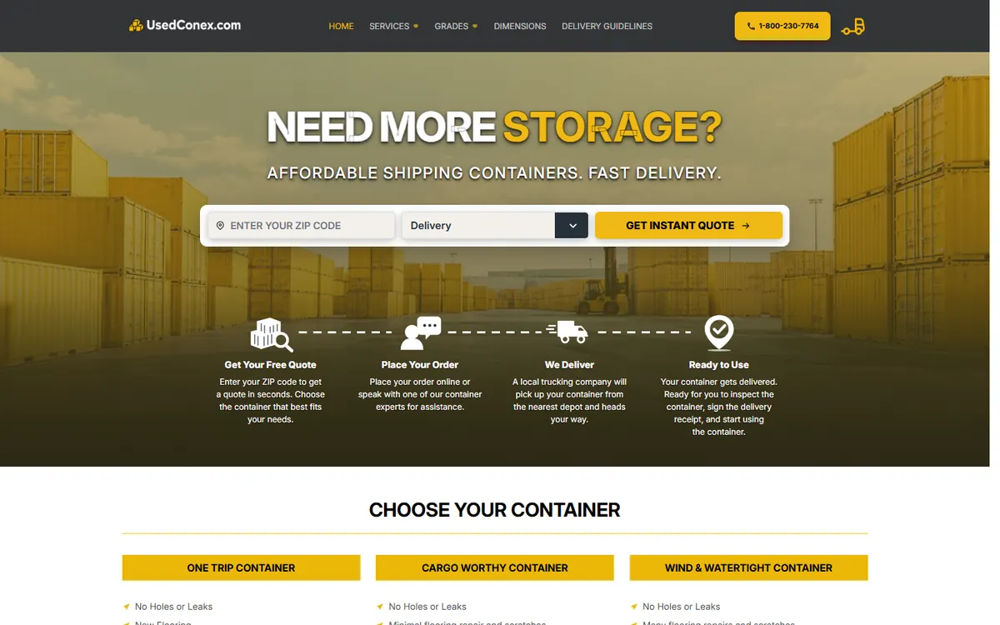

# WordPress → Shopify migration bridge

A small WordPress plugin that exposes a site's pages, posts and metadata through a token-protected endpoint, so they can be migrated into Shopify by script instead of copy and paste.

**Live site:** https://usedconex.com  
**Portfolio:** https://izainpasha.github.io

## The problem
Used Conex was moving from WordPress to Shopify and needed its page content, SEO titles and descriptions, and URLs exported reliably for the rebuild and the redirect plan.

## What I built
A plugin, available only to administrators, that generates a 40-character access token on install (stored in the WordPress database, never in code), lets the admin regenerate it, and serves the site's content and metadata to the migration scripts that rebuild each page in Shopify.

## Result
Page content and metadata moved into Shopify by script, feeding the 58 city pages and the URL redirect plan.

## Stack
PHP · WordPress · Shopify Admin API (on the import side)

---

Built by [Syed Zain Pasha](https://izainpasha.github.io) — full-stack and Shopify developer. Client data, credentials and environment files are not included.
